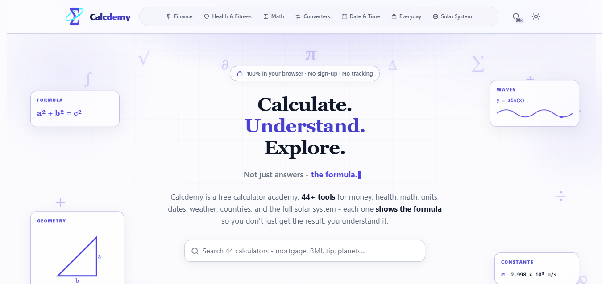
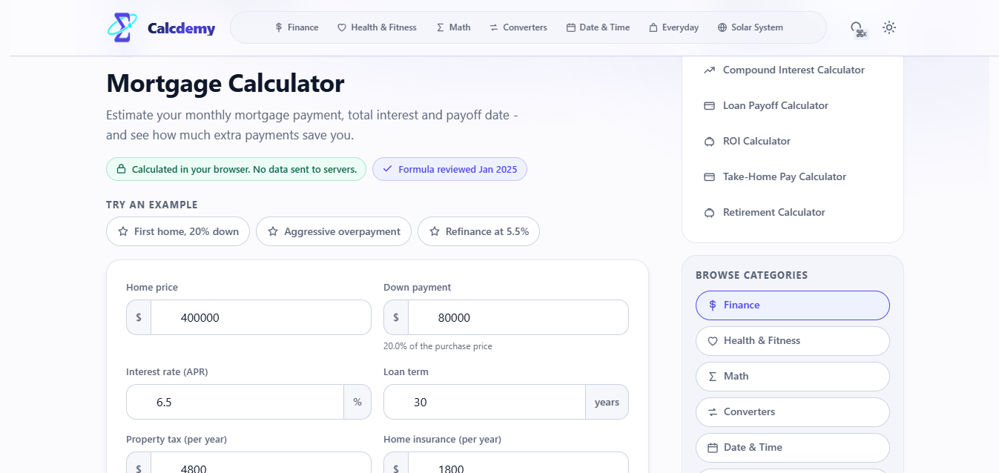
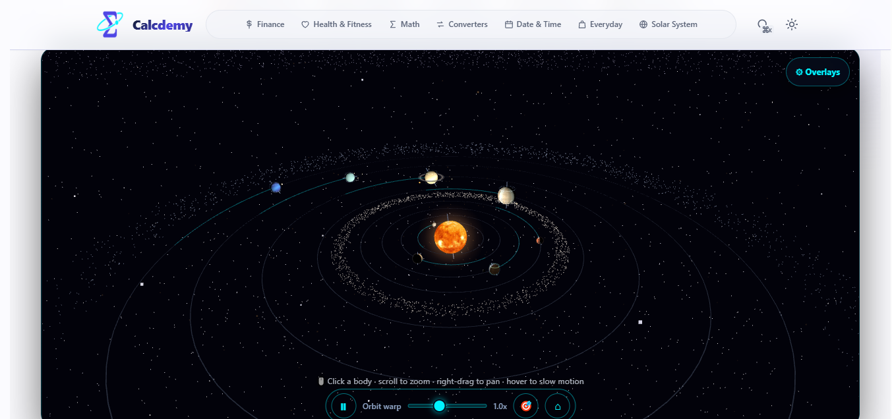
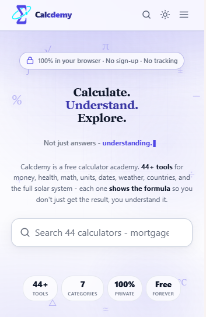

# Calcdemy

### Calculate. Learn. Explore.

**Free online calculators that reveal the formula behind every answer — so you understand the math, not just the number.**

🌐 **[calcdemy.com](https://calcdemy.com)**

---

## What is Calcdemy?

Calcdemy is a free calculator academy with **44+ browser-based tools** covering finance, health, math, unit conversions, dates, and an interactive **3D Solar System explorer**.

Every calculator shows the exact formula behind the result — with a plain-English explanation — so students, professionals, and curious minds learn while they calculate.

**No sign-up. No tracking. Everything runs in your browser.**

---

## What's inside

### 💰 Finance
Mortgage with amortization schedule · Compound Interest with monthly contributions · Loan Payoff with extra-payment savings · ROI with annualized returns

### ❤️ Health & Fitness
BMI (metric + imperial) · Calorie Deficit with Mifflin-St Jeor BMR · Body Fat (US Navy method) · Water Intake based on weight, exercise, and climate

### 🧮 Math
Percentage (4 modes) · Fraction arithmetic + simplification · Standard Deviation (sample + population) · Average, Median, Mode

### 📏 Converters
Length · Weight · Temperature · Unit Converter

### 📅 Date & Time
Age Calculator · Days Between Dates · Countdown Timer · World Clock

### 🌍 Explore
**3D Solar System** — fly to planets, compare worlds, watch day-to-night cycles · Country Info · Continent Study Map · Calendar Converter (Gregorian to Hijri, Bengali, Hebrew, Persian, and more)

---

## Screenshots

### Homepage

### Every calculator shows its formula

### 3D Solar System Explorer

### Works on every device

---

## How it works

| Principle | What it means |
|---|---|
| **100% client-side** | Calculations run in your browser — no data ever reaches a server |
| **Privacy-first** | No accounts, no tracking, no ads inside the tools |
| **Open formulas** | Every tool publishes the source of its formula with a reference |
| **Peer-reviewed** | Financial and health calculators reviewed by certified professionals |

---

## Learn more

- 🌐 **Website:** [calcdemy.com](https://calcdemy.com)
- 📖 **Glossary:** [calcdemy.com/glossary/](https://calcdemy.com/glossary/)
- ✍️ **About:** [calcdemy.com/about/](https://calcdemy.com/about/)
- 📧 **Contact:** hello@calcdemy.com

---

## Follow Calcdemy

- [YouTube](https://www.youtube.com/@calcdemy)
- [X (Twitter)](https://x.com/calcdemy)
- [Facebook](https://www.facebook.com/calcdemy)
- [Instagram](https://www.instagram.com/calcdemy/)
- [TikTok](https://www.tiktok.com/@calcdemy)

---

  <strong>Calcdemy — Calculate. Learn. Explore.</strong> 
  <em>Free. Private. Formulated.</em>

